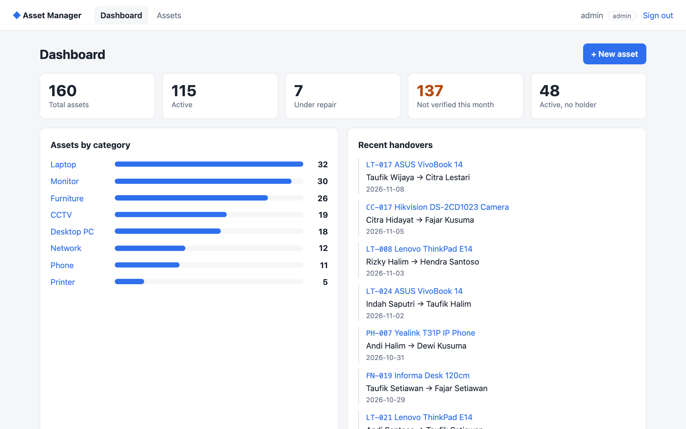
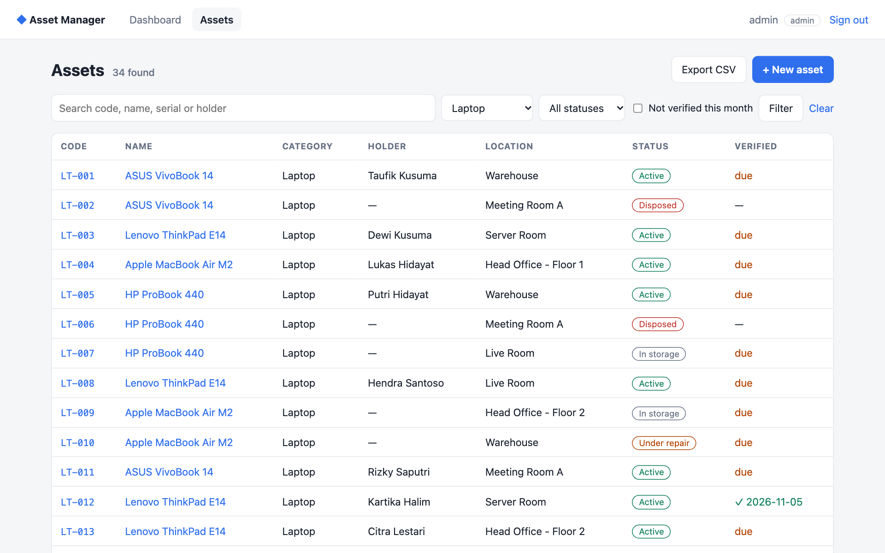
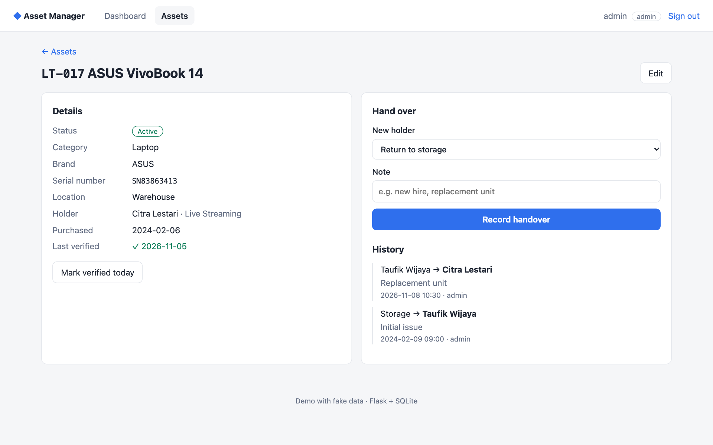

# Asset Manager (demo)

A small web app for tracking company assets: what the company owns, **who holds each item**, where it is, and **every handover** between people. It replaces the usual Excel register.

This is a clean, from-scratch demo of a system I built and run in production for an office of 400+ assets. **All data here is fake** (generated by `seed.py`), and no code or data from any employer is included.



## Features

- **Dashboard:** totals by status, assets by category, items not verified this month, active items with no holder, recent handovers
- **Asset list:** search by code, name, serial or holder; filter by category, status or "not verified this month"; pagination; CSV export of the current filter
- **Handover history:** every change of holder is recorded with who, when and why; returning an item to storage is a handover too
- **Monthly verification:** mark an item as physically checked; unverified items stand out in the list and on the dashboard
- **Roles:** `admin` can add, edit, hand over and verify; `viewer` is read only
- **Security basics:** hashed passwords, CSRF token on every form, parameterized SQL, no open redirect after login, session cookie set `HttpOnly` and `SameSite=Lax`




## Run it

```bash
python3 -m venv .venv && source .venv/bin/activate
pip install -r requirements.txt
python seed.py                      # creates assets.db with fake data
flask --app app run --port 5050
```

Open http://localhost:5050 and sign in with `admin / admin123` or `viewer / viewer123`.

With Docker:

```bash
docker build -t asset-manager-demo .
docker run --rm -p 5050:5050 asset-manager-demo
```

Set `SECRET_KEY` in the environment for anything beyond a local demo.

## Tests

```bash
pip install pytest
pytest -q
```

The tests cover login, roles, CSRF rejection, handovers, duplicate asset codes, CSV export and the open-redirect guard.

## Stack

Python · Flask · SQLite · Jinja templates · plain CSS (light and dark mode) · Gunicorn in the Docker image

## Project layout

```
app.py          routes, auth, CSRF, queries
schema.sql      tables: users, employees, assets, handovers
seed.py         fake demo data (fixed random seed, so it is reproducible)
templates/      Jinja pages
static/         stylesheet
tests/          pytest suite
```

## License

MIT
